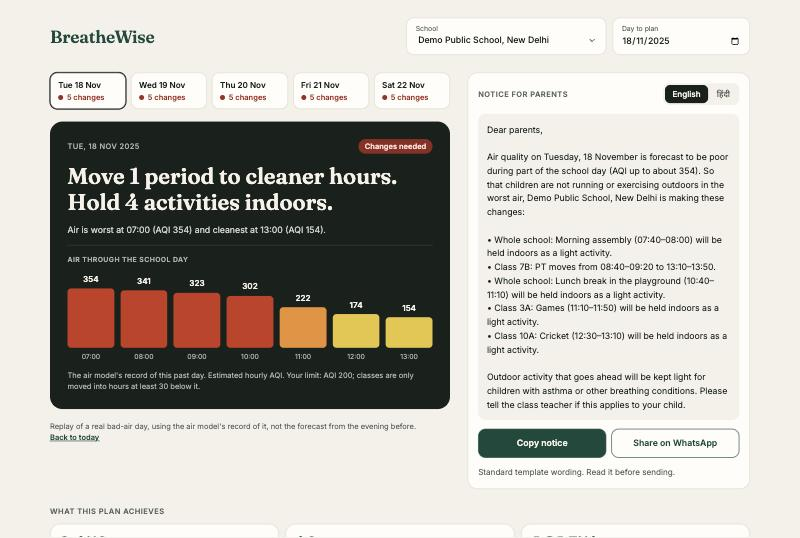
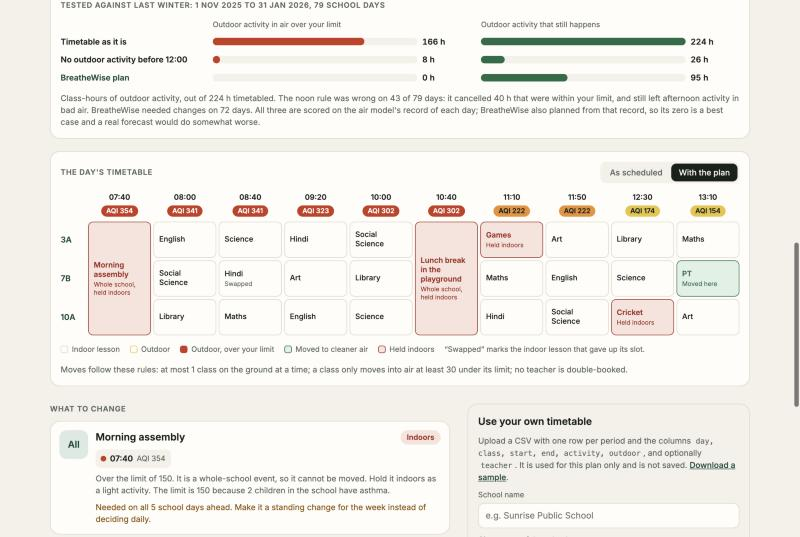
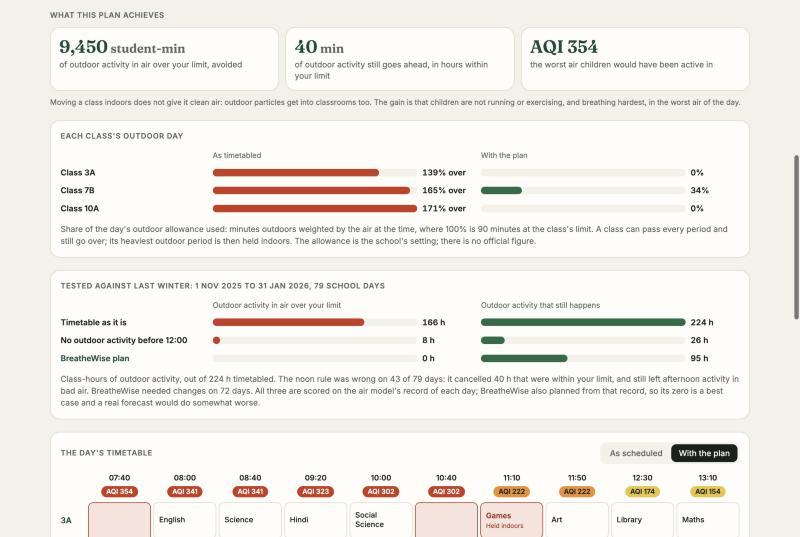

# BreatheWise

**Tells a school which outdoor periods to move or hold indoors on bad-air days, by checking
the hourly air forecast against the school's own timetable.**

Built solo for the Air track of the WeMakeDevs x AWS Environmental Hacks hackathon.

**Live:** https://pe83q72i80.execute-api.us-east-1.amazonaws.com/
(click "See a bad-air day (18 Nov 2025)" under the dark panel)



## The problem

In a north Indian winter the air is at its worst early in the morning, which is when schools
hold assembly and PT. On 18 November 2025 in New Delhi the modelled AQI was 354 at 07:00 and
154 by 13:00. A principal can see the day's AQI in any weather app. Nothing tells them which
periods to change, whether anything can be moved instead of cancelled, or what to tell
parents.

## What it does

1. The school gives it a timetable (CSV, one row per period) and its own AQI limit.
2. It fetches the hourly air forecast for the school's location.
3. For every outdoor period over the limit it either **moves** it, by swapping it with an
   indoor lesson of the same class in a cleaner hour, or **holds it indoors** and says why.
4. It writes the notice for parents in English and Hindi, with a one-tap WhatsApp share.
5. Each evening it emails staff the next school day's plan, only if something needs to
   change. Each morning it checks again and emails only what is different.
6. During the school day it shows whether students can be outside right now.



Moving a class indoors does not give it clean air: outdoor particles get into classrooms too.
What the plan does is stop children running and breathing hardest in the worst air of the day.

## Why not just "no outdoor activity before noon"?

That is the obvious rule, so the app tests it. It runs the school's own timetable through the
whole of last winter (1 Nov 2025 to 31 Jan 2026) three ways. For the demo school, 79 school
days and 224 class-hours of outdoor activity:

| Rule | Outdoor hours in over-limit air | Outdoor hours that still happen |
|---|---|---|
| Timetable as it is | 166 | 224 |
| No outdoor activity before 12:00 | 8 | 26 |
| BreatheWise plan | 0 | 95 |

The noon rule was wrong on 43 of the 79 days: it cancelled 40 hours that were within the
limit, and on other days still left afternoon activity in bad air. BreatheWise's zero is a
best case, because here it planned from the same record it is scored on; with a real forecast
some moves would land in air that turned out worse.



## Built on AWS

| Part | Code | AWS service |
|---|---|---|
| Web page and API | `app/handler.py`, `web/index.html` | Lambda behind API Gateway (HTTP API) |
| Timetables, settings, saved plans | `app/store.py` | S3 |
| Deciding what to move or hold | `app/planner.py` | Lambda (rule-based, no model) |
| Evening plan and morning update | `app/handler.py`, `app/diff.py` | EventBridge schedules at 19:00 and 06:30 IST |
| Email to staff | `app/notify.py` | SNS |
| Infrastructure | `template.yaml`, `deploy.sh` | CloudFormation (SAM transform) |

```
browser ──> API Gateway ──> Lambda ──> Open-Meteo (hourly air, outside AWS)
                              │  └──> S3 (timetables, settings, last night's plan)
EventBridge 19:00, 06:30 ─────┘  └──> SNS ──> staff email
```

One Lambda function serves the page, answers the API and runs both scheduled jobs. Every
number and every decision comes from the rule-based planner, so the same inputs always give
the same plan. The parent notice is a fixed template. The code can also have Amazon Bedrock
word the notice (`USE_BEDROCK=1`), but that is off and has not been run on a live account.

## Run it on your laptop

Python 3.11 or newer, no other installs.

```bash
python3 local_server.py
```

Open http://127.0.0.1:8765. Locally the evening plan is written to `outbox/` instead of being
emailed (`python3 local_server.py nightly`).

```bash
python3 -m unittest discover -s tests
```

79 tests cover the AQI conversion, the timetable reader, every planning rule, the winter
comparison, and the S3, SNS and Lambda paths against stand-in clients.

## How the plan is decided

- **A period's air** is the worst hourly AQI it overlaps, so a 10:40-11:10 break is judged on
  both the 10:00 and the 11:00 values.
- **The limit** defaults to AQI 200 for every class. That is the top of the national AQI's
  "Moderate" band; "Poor" starts at 201, where CPCB's description is breathing discomfort to
  most people on prolonged exposure. Schools can set their own limits, including a stricter
  one for junior classes. If an authority suspends outdoor sport (as CAQM directed for
  Delhi-NCR schools in November-December 2025), set both limits to 0.
- **Forecast margin.** A forecast can be wrong, so a class is only moved into an hour at least
  30 AQI points under the limit, and an outdoor period within 30 of the limit is flagged
  "close to your limit: check the live reading". The 30 is our choice, not a measured error.
- **Ground capacity.** A class is never moved into a slot where that would put more classes
  outdoors at once than the school's own timetable ever does (or than `max_outdoor_classes`).
- **Teachers.** If the timetable has a `teacher` column, a move is refused when it would put
  either teacher (the one moving outdoors, or the one whose lesson swaps in) in two places at
  once. Without the column, teachers are not checked, and the page says so.
- **Optional rules.** `avoid_last_period` keeps outdoor periods out of a class's last period;
  `avoid_back_to_back` stops a move giving one teacher consecutive outdoor periods. Both are
  off by default, because many schools timetable PT that way on purpose.
- **Why something is held indoors** is recorded with the decision: whole-school event, ground
  full, teacher busy, last period, or no slot clean enough.
- **Daily allowance.** A class can pass every period and still spend too long outdoors in poor
  air. Each class's outdoor minutes are weighted by the AQI at the time and compared with an
  allowance of `daily_outdoor_minutes` (90 by default) at its limit. If the day goes over, the
  class's heaviest outdoor period is held indoors until it fits. There is no official figure
  for this allowance; it is the school's to set, and 0 switches it off.
- **Order.** Over-limit periods are placed worst air first, each taking the cleanest free
  same-length indoor slot of its own class. This is a greedy rule: consistent and explainable,
  not a guaranteed optimum.
- **Asthma.** A class with children who have asthma (counts in `school.json` under `asthma`,
  or an `asthma` column in the timetable) uses the lower `asthma_limit`, 150 by default; so
  does any whole-school event. There is no official figure for this, so it is the school's to
  set. Separately, outdoor periods that go ahead above AQI 100 (the start of "Moderate", which
  CPCB ties to people with lung and heart conditions) are marked "light activity for children
  with asthma". Only counts are used, never names.

## Limits

- **Indoors is not clean air.** Classrooms are not sealed, so outdoor particles get in. The
  benefit counted here is less running and exercising in the worst air, not exposure removed.
- **Air data is modelled** (Open-Meteo, CAMS), not a sensor at the school, and hourly AQI
  values are estimates on India's national scale; the official AQI uses 24-hour averages.
  One spot check: for 18 Nov 2025 the model's 24-hour value for New Delhi works out to about
  321, against a CPCB city reading of 344 reported that morning. Same band, model lower. This
  is one day, not a validation.
- **Past days use the model's record of that day**, which is better informed than the forecast
  a school would have had the evening before. The forecast margin above is there for that.
- **Suggested moves** know about the ground and, with a teacher column, about teachers. They
  do not know about rooms, labs or exams.
- **The evening email covers stored schools only**: ones whose folder is in `data/schools/`
  when you deploy, with the address given at deploy time (AWS emails it a confirmation link).
  Timetables uploaded on the page are planned once and not stored. There is no self-service
  sign-up yet.
- **Emails go out only on days that need a change.**
- **The web address is public with no login.** API Gateway throttles it to 5 requests a
  second with a burst of 10, and uploads over 200 KB are refused. There is no per-user limit.

## Deploy to AWS

1. **Create an AWS account** at https://aws.amazon.com and sign in to the console.
2. **Install the AWS CLI.**
   ```bash
   brew install awscli
   ```
3. **Sign the CLI in** through your browser; choose region `us-east-1` when asked.
   ```bash
   aws login
   ```
4. **Deploy.** Use the email address that should get the evening plan.
   ```bash
   ./deploy.sh you@example.com
   ```
5. **Confirm the email.** AWS sends a "Subscription Confirmation" message;
   click the link in it.

The script prints the web address when it finishes. Running it again updates
the same deployment.

To send the evening plan immediately, use the `aws lambda invoke` command the
script prints. To send the plan for a chosen date instead, such as a past
bad-air day, add a date to that command:

```bash
aws lambda invoke --function-name <name> --cli-binary-format raw-in-base64-out --payload '{"date":"2025-11-18"}' /dev/stdout
```

To remove everything:

```bash
./deploy.sh --delete
```

### Settings

| Variable | Default | Meaning |
|---|---|---|
| `AWS_REGION` | `us-east-1` | Region to deploy in |
| `USE_BEDROCK` | `0` | `1` lets Bedrock word the notice |
| `BEDROCK_MODEL_ID` | `eu.amazon.nova-lite-v1:0` | Model used when Bedrock is on |
| `BEDROCK_REGION` | `eu-north-1` | Region Bedrock is called in |
| `STACK` | `breathewise` | CloudFormation stack name |

### Cost

Everything here is pay-per-use and small: Lambda, API Gateway, S3 and SNS email
sit inside the free tier at demo traffic. The API is throttled to 5 requests a second. Set a budget
alert in the Billing console anyway.

## Morning update

The evening run saves the decisions it made. At 06:30 India time a second run plans the same
day again on the morning's air data and emails staff only the decisions that are different
("PT was moves to 13:10, now held indoors"). If nothing has changed it sends nothing. The web
page shows the same difference for a day that has a saved plan.

## Changing a school's settings from the web page

Off by default. To switch it on, deploy with a passcode of your own, 10 to 64 characters:

```bash
ADMIN_PASSCODE='choose-your-own-passcode' ./deploy.sh you@example.com
```

Staff then open "School settings" on the page, enter the passcode, and can change limits,
asthma counts, the optional rules and the timetable. It is one shared passcode for the site,
not per-person accounts, and a wrong guess is slowed down, not locked out. Later deploys keep
the passcode unless you pass a new one. Because settings can now change on the site, a deploy
leaves a school that is already there alone; `RESET_SCHOOLS=1 ./deploy.sh ...` replaces it
with the files in `data/schools/`.

## Your own web address

The default address is the long `execute-api` one. To use your own domain:

1. Buy or pick a domain you control.
2. In AWS Certificate Manager, in the region you deploy to, request a certificate for the
   name (for example `breathewise.example.org`) and complete its DNS validation.
3. Deploy with both values:
   ```bash
   DOMAIN_NAME=breathewise.example.org CERTIFICATE_ARN=arn:aws:acm:... ./deploy.sh you@example.com
   ```
4. In your DNS, add a CNAME for the name pointing at the `DomainTarget` value in the stack's
   outputs.

This part of the template passes the linter but has not been run against a real domain.

## Add a school

Create `data/schools/<id>/school.json` and `timetable.csv` (copy `demo-delhi`),
then run `./deploy.sh` again to upload them.

Timetable CSV, one row per period:

```csv
day,class,start,end,activity,outdoor
mon-sat,ALL,07:40,08:00,Morning assembly,yes
mon,7B,08:40,09:20,PT,yes
mon,7B,13:10,13:50,Hindi,no
```

Use class `ALL` for whole-school events. Other column names, 12-hour times and
a missing `outdoor` column are accepted; anything the reader had to assume is
shown on the page.

`school.json` holds the name, location and settings. `thresholds` takes
`primary_limit`, `senior_limit`, `primary_max_grade`, `forecast_margin`,
`sensitive_limit`, `max_outdoor_classes`, `asthma_limit`, `daily_outdoor_minutes`,
`avoid_last_period` and `avoid_back_to_back`; `asthma` maps a class to its number of children with
asthma; `students` (`school`, `per_class`) lets the impact be shown in
student-minutes. The timetable may also carry `teacher` and `asthma` columns.

## Data and credits

Air data comes from the [Open-Meteo air quality API](https://open-meteo.com/en/docs/air-quality-api),
which serves the CAMS model. AQI values are worked out from PM2.5 and PM10 on India's national
AQI scale (CPCB breakpoints).
